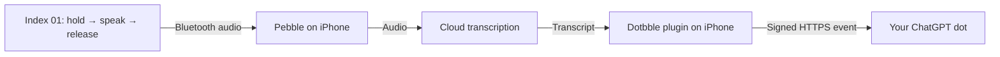

# Dotbble

**Talk to your ChatGPT dot through a Pebble Index ring.**

Hold the button, say what you want, and release. Pebble transcribes your recording, Dotbble sends the text to your dot, and your dot responds in its existing conversation. Each message includes an instruction to act immediately—you don't have to say “check for an event” or repeat the instruction yourself.

This setup works with the Mac and pairing tunnel turned off. Pair once; the connection has no scheduled expiration and survives phone restarts.

[Pebble Index 01](https://repebble.com/index) · [Pebble app](https://repebble.com/app) · [Download phone plugin](https://github.com/maddiedreese/dotbble/raw/refs/heads/main/dist/dotbble.pbw) · [Download setup files](https://github.com/maddiedreese/dotbble/archive/refs/heads/main.zip)

## How it works



- **Daily use:** ring + iPhone + internet. The plugin sends transcript text directly to OpenAI; no relay service, always-on computer, browser automation, or Shortcut is needed.
- **One-time setup:** a Mac runs a small pairing program through an OpenAI Secure MCP Tunnel. Your dot creates a subscription; the program exports its delivery credentials to your phone. Stop the program afterward.
- **Cloud transcription:** Pebble's selected speech service receives the audio. Dotbble receives the resulting text and sends text to OpenAI. Cloud transcription and Pebble's assistant are separate settings: use cloud speech recognition with the **local assistant** for this setup.
- **Lasting connection:** the exported pairing has `version: 2` and `expires: null`. It has no ten-message cap or routine renewal. Deleting the plugin's data or revoking the connection requires pairing again.
- **Requests:** the included instructions ask the dot to complete **in-chat tasks**. They preserve normal safety and approval requirements; this release does not promise unattended external actions.

## What you need

- A [Pebble Index 01](https://repebble.com/index) and an iPhone running the [Pebble app](https://repebble.com/app).
- Your own ChatGPT dot, access to **custom MCP plugins and event subscriptions**, and access to **OpenAI Platform tunnels**. Check these in your account before starting; workspace permissions apply.
- A Mac with **Python 3.11 or newer** for pairing. No Python packages are needed. This launcher uses macOS/POSIX process handling; Windows setup is not included.
- OpenAI's official [tunnel-client](https://github.com/openai/tunnel-client/releases/latest), used only during pairing.

You do not need to sign up for a separate hosting or relay service, build an iPhone app, or install Node.js unless you want to modify the plugin. Use your own OpenAI account and pairing credentials—someone else's pairing delivers to their dot.

### Tested configuration

The working setup was confirmed with **Pebble 1.15.0.1**: direct delivery with the Mac off, persistence after restarting the phone, and receipt while the phone remained locked. The physical ring setup was subsequently confirmed working. Dotbble 1.0.0 packages that implementation with public setup tools, updated naming, and automated tests.

Pebble's [current plugin guide](https://developer.repebble.com/guides/plugins/preview/) documents changes beginning in 1.16. The instructions below identify the 1.15.0.1 menu path and the newer path; newer app versions are not covered by the confirmed compatibility baseline. Check that the plugin settings load before doing the account-pairing steps.

## Setup

### 1. Connect the ring and install Dotbble

1. Install Pebble and pair your Index 01 through its device onboarding. Follow Pebble's [iPhone connection guide](https://help.repebble.com/en/articles/15724375-index-01-iphone-getting-connected), including its Bluetooth and background-location permissions.
2. Enable plugins. On **1.15.0.1**, use **Settings → Debug → Show debug options → Use experimental plugins**. On newer apps, Pebble documents **Settings → Plugins → Plugins / permissions preview**. These are Pebble's menu labels.
3. On your phone, download [dotbble.pbw](https://github.com/maddiedreese/dotbble/raw/refs/heads/main/dist/dotbble.pbw), save it to Files, then share/open it with **Pebble**. Approve the plugin's internet access to `openai.com` and `chatgpt.com` when asked.
4. Open **Apps → Plugins → Dotbble → Settings**. The page should load and report version `1.0.0`, `pairingMode: "unpaired"`, and `ready: false`. That is expected before pairing.

Already using the original “Ring Dot Direct Test” plugin? Dotbble preserves its UUID and storage keys. Install it as an update; **do not uninstall or clear a working pairing**. Keep a private copy of your original pairing file before updating.

### 2. Get the Mac setup files

Download and unzip the [repository ZIP](https://github.com/maddiedreese/dotbble/archive/refs/heads/main.zip). In Terminal, type `cd ` (including the space), drag the extracted `dotbble-main` folder into the window, then press Return.

Alternatively, if you use Git, run these lines separately:

```sh
git clone https://github.com/maddiedreese/dotbble.git
cd dotbble
```

Check Python:

```sh
python3 --version
```

If it is older than 3.11 or missing, install Python from [python.org](https://www.python.org/downloads/macos/). Leave Terminal in the folder containing `start_pairing.py`.

### 3. Create your temporary OpenAI pairing tunnel

1. Open [Platform tunnel settings](https://platform.openai.com/settings/organization/tunnels) in **your account** and create a tunnel named **Dotbble Pairing**.
2. Associate it with the Platform organization you use and the ChatGPT workspace containing your dot. Creating a tunnel requires **Tunnels Read + Manage**; using one requires **Read + Use**.
3. Create a restricted runtime API key with **Tunnels Read + Use** through your [Platform key settings](https://platform.openai.com/settings/organization/api-keys). Keep the key private; the launcher will ask for it through a hidden prompt.
4. Download the macOS `tunnel-client` from the tunnel settings download link or [official releases](https://github.com/openai/tunnel-client/releases/latest). Choose the build for your Mac, extract it, and keep any supplied companion files together. The launcher accepts its full executable path; you don't have to install it globally.

The [official tunnel guide](https://developers.openai.com/api/docs/guides/secure-mcp-tunnels) covers account permissions, workspace associations, and installing the client. Each person creates their own private connection; this repository is not a shared ChatGPT plugin service.

### 4. Run pairing and connect your dot

In the Terminal window from step 2, run:

```sh
python3 start_pairing.py
```

Enter your tunnel ID, the full path to `tunnel-client` if prompted, and your runtime API key. The key entry is hidden and is not saved by the launcher. It runs a configuration check and then starts the temporary connection. **Leave this window running until step 5.**

On ChatGPT web:

1. Open [Plugins](https://chatgpt.com/plugins), select **+ → Add custom MCP server**.
2. Name it **Dotbble Pairing**. Under **Connection**, select **Tunnel** and choose the tunnel you just created (or paste its ID).
3. Select **No authentication** for the MCP server itself; access is already controlled by the private OpenAI tunnel. Review and create the plugin, then install it in your intended workspace/account.
4. Check its discovered capabilities include the `ring.message` event and `ring_phone_pairing_status` tool.
5. Open **the dot conversation that should receive your ring messages**, attach/select **Dotbble Pairing**, and paste this instruction:

```text
Subscribe this dot to ring.message from my Dotbble Pairing plugin, with empty
event parameters, no end date, and no polling or stop task. I authorize this
persistent connection from my own Pebble phone plugin. Request ttlMs:null if
your transport supports it; do not put ttlMs in the event-filter arguments.
The server defaults to no expiration when ttlMs is omitted. Report the actual
subscription result and check ring_phone_pairing_status.

For every new event, act on the spoken request in data.text now and reply in
this dot conversation, without waiting for me to ask you to check for events.
The phone sends these instructions with every message. Complete in-chat tasks
and follow normal safety and approval requirements. Process each receipt_id
once. Keep the subscription active after responding. After setup the pairing
server will be off: use each delivered event directly, without polling it or
calling the setup server.
```

The status tool should show **one active subscription** and **one non-expiring subscription**. The local `.private/state/last_subscription_grant.json` records `callback_verified: true` and `refresh_before: null`. If the dot reports a finite lifetime, fix the subscription before continuing—do not edit an expiry in a file.

### 5. Stop the Mac program and export the pairing

Press **Control-C** in the launcher window and wait for **“Pairing runtime stopped.”** Then run:

```sh
python3 finish_pairing.py
```

This creates **`.private/MY-PHONE-PAIRING.json`**, only after the runtime has stopped and a non-expiring subscription exists. Repeating the command retains a matching export and its message identity.

In Finder, open the setup folder and press **Command-Shift-period** to show `.private`. Transfer `MY-PHONE-PAIRING.json` privately to your phone (for example, with AirDrop). **Do not post this file or paste it into ChatGPT.** It contains the signing credential for your dot.

In **Dotbble → Settings** on the phone:

1. Paste the complete JSON file into **Private pairing JSON**.
2. Tap **Pair connection**.
3. Confirm **`ready: true`**, **`pairingMode: "non-expiring"`**, and **`expires: null`**.

You can now turn off the Mac. The tunnel client and pairing server are not part of daily message delivery. Keep the setup folder private for future maintenance.

### 6. Route Index recordings to your dot

In Pebble's Index settings, configure:

| Setting | Value |
| --- | --- |
| Speech recognition | Your preferred **cloud** transcription option |
| Assistant / agent | **Local** |
| Capture action | **Notes** |
| Notes destination | **Dotbble** |
| Cloud backup | **Off** for this configuration |
| Separate outgoing webhook | Not needed |

“Local assistant” is the routing step that hands the transcript to Dotbble; it does **not** mean transcription must be local. Dotbble uses the notes action to receive the text, then signs and sends it directly to OpenAI.

Hold the ring button and say **“Write a two-sentence story about a blue kite.”** Release it. Your dot should respond in its usual conversation without an additional prompt. You don't need to speak the delivery instructions.

### 7. Verify your own setup

1. Turn the Mac off and send a request. Confirm a **reply in your dot**, not just “Sent” in Pebble.
2. Restart the phone, unlock it once, and open Pebble. Send again without re-pairing.
3. Lock the phone and leave it idle for several minutes. Use the ring without unlocking it. Check the dot from another device, or compare the event/reply time with when you unlocked your phone. Don't force-quit Pebble for this background test.
4. Repeat later or the next day. The pairing status should still say `non-expiring`.

Cloud transcription and event delivery require internet access. These checks verify your account, ring, and phone configuration together.

## Troubleshooting

| Symptom | What to check |
| --- | --- |
| `start_pairing.py` not found | Terminal must be inside the extracted repository folder. Use the `cd ` + drag-folder step above; don't paste a shell script's shebang into Terminal. |
| Tunnel missing in ChatGPT | Check the tunnel's ChatGPT workspace association and **Read + Use** permissions, then keep the launcher running during discovery. |
| Plugin settings don't load | Confirm plugin preview is enabled and check the Pebble version against the tested baseline. |
| Dotbble not offered as notes destination | Pair it first (`ready: true`), then reopen Index settings. |
| `one-hour-test` | An old version-1 pairing was imported. Use the newly exported file with `version: 2` and `expires: null`; don't manually modify the old file. |
| No transcript in Pebble | Check ring connection, microphone/recording, cloud speech settings, and internet access. This happens before Dotbble receives text. |
| Transcript exists, but no delivery | Check Notes → Dotbble and the **local** assistant. Open Dotbble settings for status and diagnostics. |
| HTTP 200, but no reply | HTTP success confirms receipt, not completion. Check the target dot's active event subscription and its task activity. Don't create duplicate subscriptions to troubleshoot. |
| Delivery waits until opening Pebble | Recheck Pebble's background permissions, ring connection, and local assistant setting. Use the actual ring for the locked-phone test; recording on the phone and then locking it is a different path. |
| `pending: true` | Check the dot before tapping **Retry pending**. Retries reuse the same event ID; repeating the spoken request creates a new event. Pending retries are limited to three attempts within five minutes. |
| HTTP 410 / no longer paired | The receiver no longer accepts this connection. The plugin clears its credential on 410; create a fresh subscription and pairing. |

## Privacy and connection lifecycle

The plugin stores its credential and any unconfirmed message in ordinary Pebble plugin storage. It does not use the iPhone Keychain. Successful delivery clears the pending transcript from **Dotbble's** storage; Pebble and your cloud services have their own history and retention. Local diagnostics contain timestamps, stage names, and HTTP statuses, not transcripts or credentials.

Keep `.private/` and your pairing JSON out of Git, issue reports, screenshots, and shared ZIPs. To stop using Dotbble, tap **Disconnect and clear** on the phone and disable/delete the event subscription in ChatGPT. Removing a local credential does not recall a message already sent or revoke copies of that credential.

The pairing server is offline during normal use, so it cannot receive unsubscribe or key-rotation calls then. For server-side maintenance, restart the launcher with the **same private state**, perform the subscription operation in ChatGPT, then stop it. If credentials change, export and import the new pairing; `finish_pairing.py` refuses to overwrite a conflicting existing export. Move that old export out of `.private/` privately before exporting the replacement. Never reuse the same pairing file on two phones: it contains a per-device message identity.

See [architecture and protocol details](docs/architecture.md) and [security reporting](SECURITY.md).

## Build, test, and customize

The prebuilt [PBW](dist/dotbble.pbw) is ready to install. To build from source, use Node.js 20.19+ and Python 3.11+:

```sh
npm ci
npm test
npm run check:dist
```

`npm test` builds the plugin and runs the JavaScript and Python tests without a ring, credentials, or live API calls. `npm run build` alone writes `dist/dotbble.pbw` and its [SHA-256 checksum](dist/SHA256SUMS.txt). The package is deterministic; CI checks that committed artifacts match the source.

- [`phone/core.js`](phone/core.js): per-message instruction, validation, event body, and signing.
- [`phone/sender-entry.js`](phone/sender-entry.js): Pebble actions, persistent pairing, delivery, and retry handling.
- [`phone/config.html`](phone/config.html): pairing and status UI.
- [`pairing.py`](pairing.py) / [`bridge.py`](bridge.py): subscription negotiation and callback verification.
- [`start_pairing.py`](start_pairing.py) / [`finish_pairing.py`](finish_pairing.py): one-time setup and private export.

To change what accompanies every spoken request, edit `MESSAGE_PREAMBLE` in `phone/core.js`, rebuild, and reinstall the PBW as an update. The default keeps requests in the dot conversation. Changing that instruction does not bypass ChatGPT's approvals or grant extra tool access.

## Links and credits

- [Pebble Index 01](https://repebble.com/index), [app](https://repebble.com/app), and [Index developer docs](https://developer.repebble.com/index-01/)
- [Pebble plugin guide](https://developer.repebble.com/guides/plugins/preview/) and [mobile app source](https://github.com/coredevices/mobileapp)
- [OpenAI MCP Events](https://developers.openai.com/plugins/build/mcp-events), [Secure MCP Tunnel](https://developers.openai.com/api/docs/guides/secure-mcp-tunnels), and [custom MCP setup](https://developers.openai.com/api/docs/guides/custom-mcp-server)
- [ChatGPT dots](https://learn.chatgpt.com/docs/dots)

Dotbble is an independent project, not affiliated with Pebble or OpenAI. Released under the [MIT license](LICENSE). The bundled HMAC/SHA-256 implementation is from [@noble/hashes](https://github.com/paulmillr/noble-hashes), also MIT; its [license](phone/LICENSE-noble-hashes.txt) is included in the PBW.
